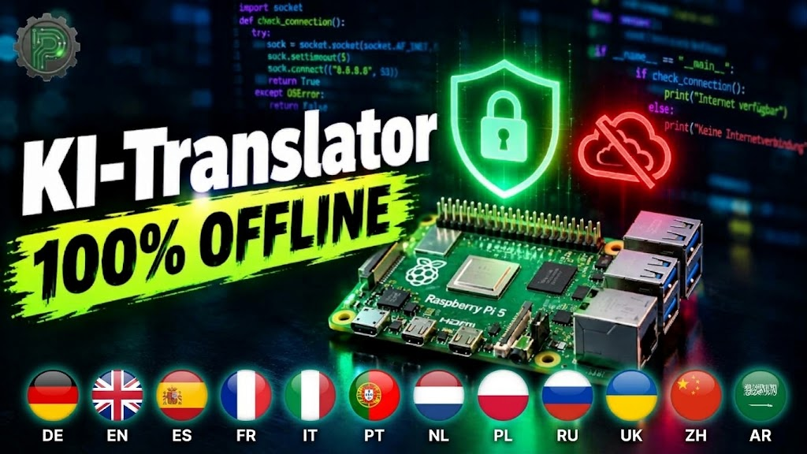

# 🌍 Prilchen Labs – Offline AI Translator

Ein lokaler KI-Sprachübersetzer auf Basis des Raspberry Pi 5.

Dieses Projekt verwandelt einen Raspberry Pi 5 in einen eigenständigen Sprachübersetzer. Gesprochene Sprache wird aufgenommen, lokal erkannt, durch eine KI übersetzt und anschließend wieder ausgegeben.

**Das Besondere: Die gesamte Verarbeitung erfolgt lokal auf dem Raspberry Pi. Eine Cloud-Verbindung oder ein kostenpflichtiger Online-Dienst ist nicht erforderlich.**

## 🧠 Verwendete Software

| Komponente | Aufgabe |
|---|---|
| Whisper.cpp | Spracherkennung (Speech-to-Text) |
| Ollama | Lokale KI-Umgebung |
| Gemma 3 | Übersetzung |
| Piper TTS | Sprachausgabe (Text-to-Speech) |
| Python / Tkinter | Grafische Benutzeroberfläche |

## 🔧 Benötigte Hardware

- Raspberry Pi 5 (mindestens 4 GB RAM)
- Aktive Kühlung empfohlen
- MicroSD-Karte oder NVMe SSD
- USB-Mikrofon
- Lautsprecher oder HDMI-Monitor mit Audioausgabe

Optional:
- 3,5-Zoll-Touchdisplay
- USB-Soundkarte

## 🌐 Unterstützte Sprachen

Im Beispielprojekt sind folgende Sprachen eingerichtet:

- Deutsch
- Englisch
- Spanisch
- Französisch

Weitere Sprachen können durch zusätzliche Sprachmodelle ergänzt werden.

## 🔒 Datenschutz

Die Sprachaufnahme, Spracherkennung, Übersetzung und Sprachausgabe erfolgen lokal.

Es werden keine Gesprächsinhalte an externe KI-Dienste übertragen.

Hinweis: Für die Installation und den Download der benötigten Modelle wird eine Internetverbindung benötigt.

## 🚀 Installation

Die vollständige Installationsanleitung mit allen Linux-Befehlen findest du in meinem Tutorial:

https://prilchen.de/raspberry-pi-5-sprachuebersetzer-mit-schutz-der-privatsphaere/

## 📂 Projektstruktur

- `app/` – Übersetzungsprogramm
- `gui/` – Grafische Oberfläche
- `scripts/` – Installationsskripte
- `config/` – Beispielkonfiguration
- `docs/` – Zusätzliche Dokumentation

## 👨‍🔧 Projekt und Anleitung

Das Projekt stammt von Prilchen Labs.

Weitere Elektronik-, Arduino-, ESP32- und Raspberry-Pi-Projekte:

https://prilchen.de/

Viel Spaß beim Nachbauen!
